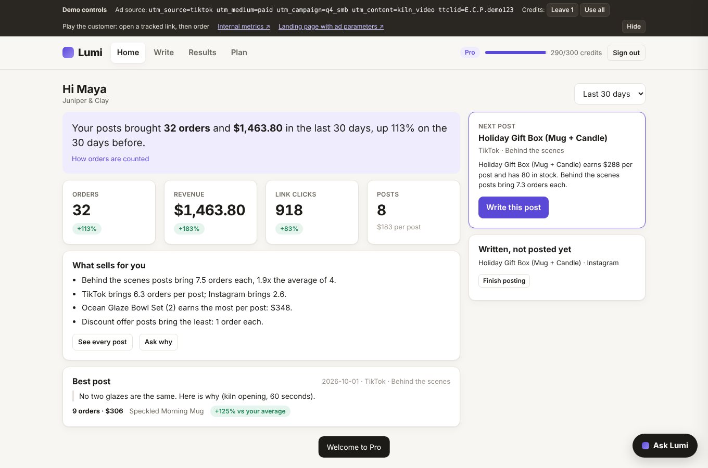
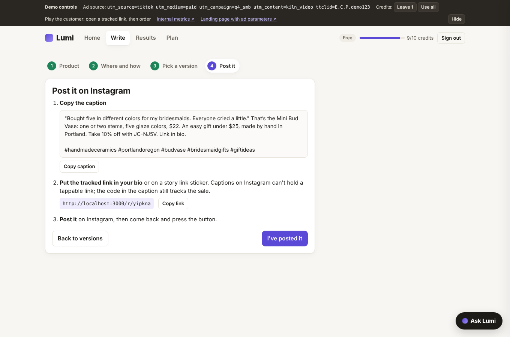
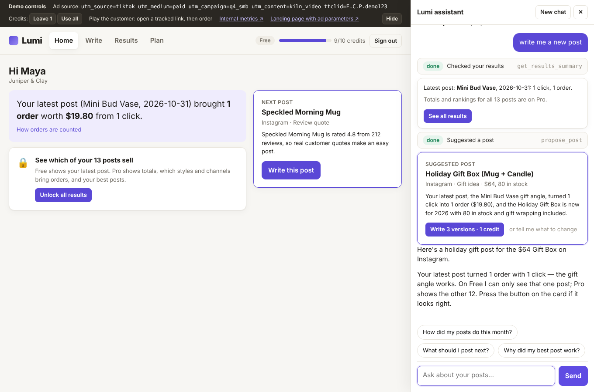
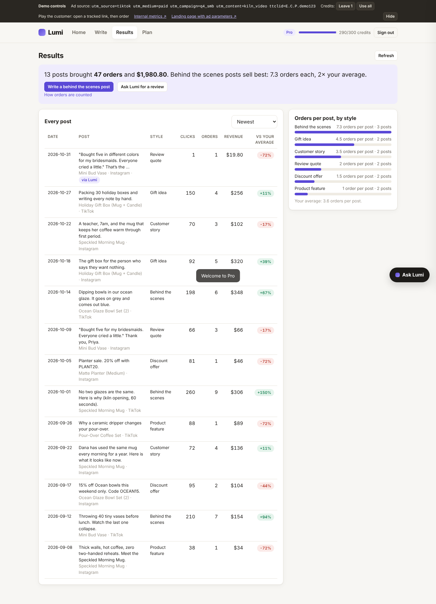
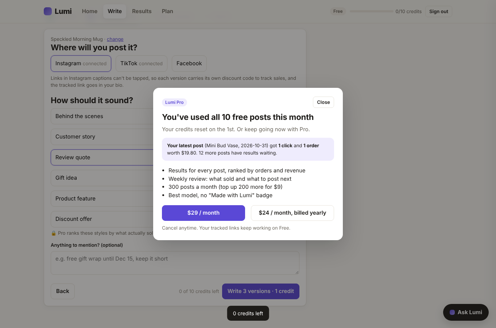
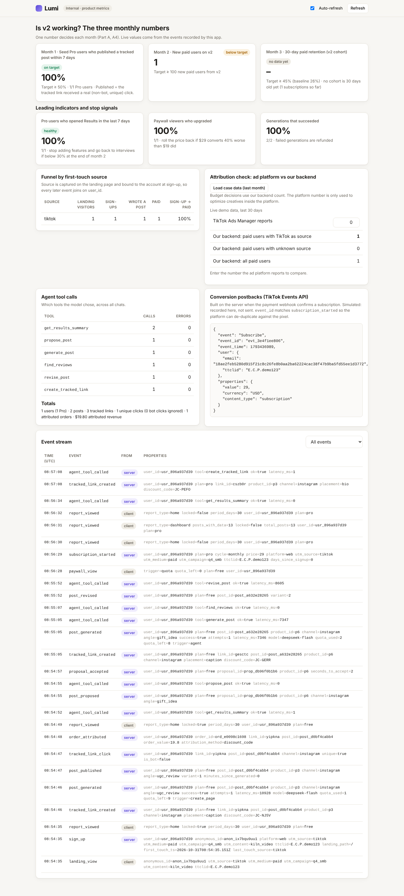

# Lumi v2: see which posts bring orders

Lumi is an AI marketing assistant for small overseas shops. **v2 does one thing: every post Lumi writes carries a tracked link and its own discount code, so the merchant sees clicks, orders and revenue per post, and Lumi writes the next post based on what sold.**

Why this direction: paying users' top complaint is "I don't know if my posts bring orders" (141 mentions, 68% from paying users), and paid users churn fast (TikTok payers: 8% still paying after 30 days). The full reasoning is in Part A and in [docs/PRD.md](docs/PRD.md).

| Folder | What it is | How to open |
| --- | --- | --- |
| [`prototype/`](prototype/index.html) | Clickable HTML prototype with hard-coded data | Double-click `prototype/index.html` |
| [`docs/`](docs/PRD.md) | Product requirements (in Chinese) | `docs/PRD.md` |
| [`app/`](app/README.md) | Runnable product: Home with this period's results, a 4-step Write flow, an assistant panel (multi-turn agent, 7 tools), server-side quota, real event tracking, UTM capture, tracked links, simulated store and payments, internal metrics page, tests and an eval set | 3 steps below |

## Run the app (3 steps, Node 20+)

```bash
cd app && npm install && cp .env.example .env   # 1. install and copy config
# 2. put your key in app/.env: LLM_API_KEY, LLM_BASE_URL, LLM_MODEL
npm start                                       # 3. open http://localhost:3000
```

Any OpenAI-compatible model with tool calling works: DeepSeek, Kimi, Zhipu GLM, Qwen. Base URLs, model names and where to get a key are in [`app/.env.example`](app/.env.example). Without a key, everything except chat and generation still works.

## 5-minute review path

The dark strip at the top is **Demo controls**: reviewer-only shortcuts kept out of the product (ad source, credit fast-forward, the metrics page). Hide it any time.

1. **Arrive from an ad.** Open <http://localhost:3000/?utm_source=tiktok&utm_medium=paid&utm_campaign=q4_smb&ttclid=E.C.P.demo123> and sign up with any email. The Demo controls show the captured source.
2. **Home.** One sentence on how the latest post did, a suggestion for the next post, and a getting-started checklist. On Free the server returns only the latest post; the rest is behind a lock.
3. **Write a post (4 steps).** "Write this post" → pick the product (the suggested one is preselected with its reason) → pick where and how it should sound → "Write 3 versions · 1 credit" → pick a version → the posting checklist: copy the caption, put the tracked link in your bio (Instagram and TikTok captions can't hold a tappable link, so each version carries its own discount code), then "I've posted it".
4. **Be the customer.** The done screen links to the tracked link. Enter the discount code and place the simulated order. Home now shows the click and the order.
5. **Ask Lumi.** "Ask Lumi" (bottom right) opens the assistant on any page. Try "write me a new post": the model checks results and calls `propose_post`, which shows a card with a **Write 3 versions · 1 credit** button. No credit is spent until you press it; the server refuses `generate_post` for a proposal that wasn't pressed. Then try "make version 2 shorter" (`revise_post`, free). Every tool call is a visible step; tap one to see its arguments and result.
6. **Hit the paywall.** Demo controls → "Use all", then write again. The paywall uses the merchant's own latest result. Pay (simulated): the plan changes only when the signed webhook arrives. Home now shows totals, change vs the previous period and what sells.
7. **Check the numbers.** Demo controls → Internal metrics (<http://localhost:3000/admin>): the three monthly metrics from Part A, proposal acceptance and publish rates, funnel by first-touch source, the ad-platform vs backend reconciliation ("Load case data"), the TikTok Events API postback, and the raw event stream.

## Where each Part A answer lives

| Part A | In Part B |
| --- | --- |
| A2 direction: results loop | Prototype and app: Home → Write (4 steps, ending in "I've posted it") → tracked clicks and orders back on Home; PRD §3–4 |
| A3 pricing: Free 10 / Pro $29, 300 fair use, $9 top-up | `app/lib/config.js` (one source of truth), paywall, Plan page; PRD §5 |
| A4 one number per month | `/admin` computes all three live; prototype Metrics tab; PRD §2 |
| A11 tracking plan | Every event recorded by `store.track()`, money events server-side only, browser limited to a whitelist; PRD §6 |
| A12 data mismatch | `/admin` reconciliation panel: 118 + 31 = 149 < 162 |
| A13 ad → payment chain | Landing captures UTM and ttclid → bound to the account at sign-up → carried on `subscription_started` → server-side postback with the same `event_id` |

## Proof it works

- `cd app && npm test` runs 12 end-to-end tests against the real server with a stub model: a credit is only spent after the proposal button is pressed (typing "yes" is refused), edits are free, Instagram captions carry the code and no URL, quota cannot be bypassed by calling the API directly, concurrent requests cannot overspend, "I've posted it" logs `post_published` once, UTM reaches `sign_up` and `subscription_started`, bad webhook signatures are rejected, bot clicks are ignored, orders attribute by code, invalid tool arguments are recovered.
- `cd app && npm run eval` runs 28 cases (4 of them multi-turn: propose → press the button → write → edit) against your configured model. It scores tool choice, credit safety (no credit without a button press, must be 100%), grounding (no invented $ amounts), format (no tables, short answers), platform rules and reply language. Results are saved to `app/eval/results/`. Last run on DeepSeek V4.1 Flash (`deepseek-flash`, 2026-10-31): 28/28 pass, credit safety 100%, 1.2 tool calls per question, median 3.9 s per single-turn case. See [`app/eval/results/deepseek-flash.md`](app/eval/results/deepseek-flash.md).

## Screenshots

| | |
| --- | --- |
|  |  |
|  |  |
|  |  |

## What is simplified in the demo

- Storage is one JSON file and chat history is in memory. Production: Postgres, and Redis or row locks for quota.
- Payments, the Shopify store and the TikTok Events API are simulated. The webhook is still signed and is the only thing that changes a plan.
- Sign-in is email only, kept in an httpOnly cookie.
- Canceling Pro downgrades immediately instead of at the end of the period.
