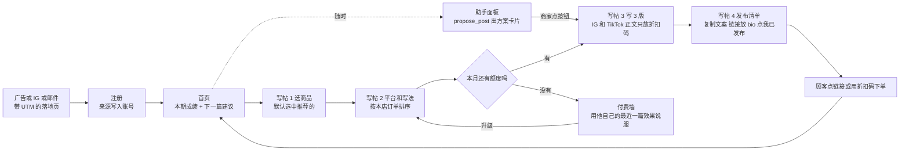

# Lumi v2「效果闭环」PRD

| 项目 | 内容 |
| --- | --- |
| 版本 | v1.2 评审稿，2026-11-01（v1.1 首页、写帖四步、助手按钮确认；v1.2 修复重复扣费、订阅状态，补多模型适配） |
| 负责人 | bleak（产品） |
| 评审 | 业务负责人、工程师 |
| 相关 | 可点击原型 `prototype/index.html`；可运行版本 `app/`（README 三步启动） |

**一句话：** v2 让商家看到每一篇贴文带来了多少点击和订单，再由 AI 根据效果写下一篇。

---

## 1. 目标用户与要解决的问题

**目标用户：** 在 Shopify 或独立站开店、自己运营 Instagram 和 TikTok 的海外小商家，1 到 5 人，月销售额 $2k–$50k。原型和演示里的示例商家是美国波特兰的手作陶瓷店 Juniper & Clay。

**问题：** 商家用 Lumi 发了贴文，却不知道它有没有带来订单，觉得付费不值，一个月后就走。

| 证据（题目数据） | 数字 |
| --- | --- |
| 付费用户最集中的抱怨 | 不知道贴文有没有效果被提及 141 次，68% 来自付费用户，约 96 人，相当于付费用户的 22% |
| 付费留不住 | 近 90 天新增付费 540 人，30 天后约剩 143 人；其中 TikTok 带来 372 人，只剩约 30 人（8%） |
| 留得住的人有明确需求 | SEO 和推荐来的付费用户 30 日留存 71%–80% |
| 生成本身已无差异 | 通用 AI 都能免费写文案，Lumi 要收费，就要证明能带来订单 |

**这一版不解决：** 内容更多样（模板）、多语言、多人协作，理由见第 4 节。

---

## 2. 本版本要验证的假设与成功标准

| # | 假设 | 怎么验证 | 成功标准 | 停止或转向信号 |
| --- | --- | --- | --- | --- |
| H1 | 商家愿意在贴文里用追踪链接或折扣码 | 30–50 位种子 Pro 用户，第 1 月 | 7 天内发布追踪贴文的比例 **≥ 50%**（以追踪链接收到第一个真实点击为准） | < 30%：先访谈，查发布流程是否太麻烦 |
| H2 | 看得到效果，商家会每周回来 | `report_viewed` 周活跃 | 种子用户每周打开 Results 的比例 **≥ 40%** | 第 2 月末 < 30%：停止加功能，回到访谈，评估转向 Team 版 |
| H3 | 看得到效果能提高付费留存 | v2 付费队列 vs 改版前 | v2 付费 30 日留存 **≥ 45%**（现约 26%），且比老队列高 10 个百分点以上 | 差距 < 10 个百分点：评估转向 |
| H4 | 效果能撑起 $29 定价 | 新用户付费墙转化率 | $29 的转化率不低于 $19 时期的 60% | 低 40% 以上：回调价格或加 7 天试用 |

**每月一个判断数字（与 Part A 的 A4 一致）：** 第 1 月看 H1；第 2 月看 v2 新增付费 ≥ 100；第 3 月看 H3。三个数字都在可运行版本的 `/admin` 页面实时计算，原型的 Metrics 页展示了它们的样子。

---

## 3. 核心用户流程

1. **进入：** 广告链接带 `utm_*`，TikTok 自动加 `ttclid`。落地页把它们存进第一方 cookie 和 localStorage，上报 `landing_view`。
2. **注册：** 服务端把首次和最后触点写进用户记录，之后所有事件都用 `user_id` 串联。演示版注册即连接演示店铺。
3. **首页：** 第一句话回答「这段时间帖子带来多少订单、比上期多还是少」，下面是各项变化、什么卖得好、表现最好的一篇。右侧是「下一篇写什么」和一个按钮，以及新手清单（连接店铺、写第一篇、发布并放好链接、收到第一次点击）。Free 只看到最近一篇，其余加锁。
4. **写帖四步：** ① 选商品，默认选中数据推荐的那个并写明理由；② 选平台和写法，Pro 的写法按本店每篇平均订单排序，Free 只显示一把锁；③ 写 3 版，按钮写明「用 1 次额度」，服务端先占位、成功才扣减；④ 发布清单：复制文案，把追踪链接放进 bio 或快拍链接贴纸，发完点「I've posted it」。
5. **追踪：** 每次生成自动创建一条短链（带 UTM）和一个专属折扣码。Instagram 和 TikTok 正文里的链接点不开，所以正文只放折扣码并写 link in bio；Facebook 和邮件把链接写进正文。
6. **归因：** 短链跳转时服务端记点击；订单先按折扣码匹配，没有码就看 30 天内的最后一次追踪点击。
7. **助手：** 右下角按钮在任何页面打开助手，提问时带上当前页面。要写帖时，助手调 `propose_post` 出一张方案卡片；商家点卡片上的按钮，服务端直接写这篇（扣 1 次额度），助手只负责说一句该从哪版开始。助手本身没有能扣额度的工具。改稿用 `revise_post`，不扣额度。
8. **看效果：** 首页和 Results 先给一句带数字的结论，再给排序；新帖子还没有点击时显示「等待第一次点击」。

---

## 4. 功能清单与优先级

| 优先级 | 功能 | 说明 | 对应假设 | 演示版 |
| --- | --- | --- | --- | --- |
| P0 | 追踪短链 + UTM | 每篇自动生成；跳转服务记点击、24 小时去重、过滤爬虫 | H1 | 已实现 |
| P0 | 专属折扣码 | 每篇一个码，核销即归因；没装 Shopify 的商家也能用 | H1 | 已实现 |
| P0 | 首页 | 一句结论、和上期对比、什么卖得好、最好的一篇、下一篇建议、新手清单；Free 只看最近 1 篇 | H2 | 已实现 |
| P0 | 写帖四步 + 发布清单 | 推荐商品预选；写法按本店订单排序；链接放 bio 的指引；「I've posted it」 | H1 | 已实现 |
| P0 | Results 效果看板 | 每篇点击、订单、收入、对比平均；按写法分组；手机上表格变卡片；Free 只看最近 1 篇 | H2 | 已实现 |
| P0 | 服务端额度与新定价 | Free 10 次，Pro $29 / 300 次；付费墙 | H4 | 已实现 |
| P0 | 埋点与归因修复 | 第 6 节事件；付费回传 TikTok Events API，用 `event_id` 去重 | 全部 | 已实现，回传为模拟 |
| P1 | AI 助手（侧边面板 + 工具调用） | 解释成绩、推荐下一篇、改稿、生成追踪链接；扣额度只能靠方案卡片上的按钮 | H2 | 已实现，6 个工具 + 按钮触发写帖 |
| P1 | AI 周复盘 | 每周一生成：哪类写法最赚钱、下周发什么；前 2 周可人工 + AI 半自动 | H2、H3 | 由助手按需生成 |
| P1 | 按历史效果推荐写法 | 写帖第 2 步按店铺每篇平均订单排序；首页给出下一篇建议 | H3 | 已实现 |
| P2 | Shopify 订单自动对接 | 第一版靠折扣码，第 6 周接 webhook | H3 | 用模拟店铺代替 |
| P2 | IG / TikTok 互动数据 | 依赖平台接口审核，第 1 天提交申请 | H2 | 未做 |
| P2 | 效果分享图 + 推荐奖励 | 「这篇本周带来 12 单」，推荐双方各得 1 个月 Pro | 增长 | 未做 |
| P2 | 连接 Shopify 自动导入 | 首次使用第一屏只做连接，导入商品和最近 90 天订单 | H1 | 用「演示店铺」代替 |
| P2 | 每周复盘推送 | 每周一邮件或站内推送：上周哪篇最好、下周写什么 | H2 | 由助手按需生成 |
| P2 | 助手人工抽检 | 每次改提示词抽 10 段回答，按对不对、有没有用、像不像人话、该不该调工具打分 | 质量 | 未做，自动评测已有 |

**明确不做：**

| 不做 | 理由 |
| --- | --- |
| 更多模板 | 312 次提及中付费用户只占 6%（约 19 人），做了主要推高免费用量和成本。用 AI 补 20 个模板走配置，不占开发时间 |
| 加大 TikTok 投放 | 30 日留存 8%，平台归因还高估约 37%。产品留得住人之前，多投的预算大多会流失 |
| 多人协作 | 付费占 85% 但只有 40 次提及（约 34 人），权限和席位计费工程量大，留给后续 Team 版 |
| 多语言 | 模型本身支持多语言，放进日常迭代，不配做唯一方向 |
| 自动发布到 IG / TikTok | 平台审核周期长，复制粘贴已足够验证假设 |
| App 端新功能 | App 付费来源未知占 34%，先把付费引导到 Web |

---

## 5. 付费边界与定价

| | Free | Pro |
| --- | --- | --- |
| 价格 | $0 | **$29 / 月**，年付 $24 / 月 |
| 生成次数 | 10 次 / 月 | 300 次 / 月（公平使用），超出可买 $9 / 200 次 |
| 追踪短链 + 折扣码 | 有 | 有 |
| Results | 只看最近 1 篇 | 全部贴文、排序、按写法分组 |
| AI 周复盘 | 无 | 有 |
| 助手消息 | 每天 30 条 | 每天 300 条 |
| 模型 | 低成本模型 | 主力模型 |
| Made with Lumi 标识 | 追踪链接落地页带标识 | 可去掉 |

**为什么这样划：** 免费用户能看到最近 1 篇的效果，先尝到价值；想知道「哪篇最赚钱」要付费。免费次数从 30 降到 10，因为免费用户的模型成本超过全部收入。取消「无限」，因为用量最高的 10% Pro 每人每月成本 $31，高于 $19 的收入。

**估算（计算过程见 Part A 的 A3）：**

| 每月 | 调整前 | 调整后 |
| --- | --- | --- |
| 收入 | $8,360 | 约 $10,580 |
| 模型成本 | 约 $16,838 | 约 $6,269 |
| 毛利 | 约 −$8,478 | 约 +$4,311（41%） |

**上线方式：** 老 Pro 用户保留 $19 三个月，老免费用户保留 30 次一个月并提前邮件通知，先用新用户的转化率验证 $29。付费引导到 Web（Stripe），App 内支付有 15%–30% 抽成，来源也更容易丢。

---

## 6. 埋点表

**原则：** 和钱、额度、归因有关的事件一律在服务端上报，准确且不受广告拦截影响；只有「用户看到了什么」在前端上报。前端只能上报白名单里的 3 个事件，其他事件名会被服务端拒绝。

**核心事件（来自 Part A 的 A11）：**

| 事件名 | 触发时机 | 关键属性 | 上报端 | 对应指标 |
| --- | --- | --- | --- | --- |
| `landing_view` | 落地页加载 | anonymous_id、utm_source/medium/campaign/content、ttclid、referrer | 前端：只有浏览器拿得到 URL 参数 | 渠道到达量 |
| `sign_up` | 账号创建成功 | user_id、anonymous_id、首次触点全部来源字段、last_touch_source、platform | 服务端 | 分渠道注册转化率 |
| `post_generated` | 一次生成结束，成功或失败都报 | user_id、plan、post_id、product_id、channel、angle、success、error、attempts、latency_ms、model、quota_used、quota_left、trigger | 服务端 | 人均生成、成功率、人均成本 |
| `tracked_link_created` | 生成追踪短链或折扣码 | user_id、link_id、post_id、product_id、channel、discount_code | 服务端 | 追踪贴文采用率（H1） |
| `post_published` | 商家在发布清单点「I've posted it」，每篇只报一次 | user_id、post_id、product_id、channel、angle、variant、minutes_since_generated | 服务端 | 写完到发布的转化；H1 的早期信号 |
| `tracked_link_click` | 顾客点追踪短链 | link_id、post_id、channel、unique、is_bot、referrer | 服务端：在跳转时记录 | 每篇点击；H1 的「已发布」判定 |
| `order_attributed` | 订单命中折扣码，或 30 天内点过短链 | order_id、link_id、post_id、order_value、attribution_method | 服务端 | 每篇订单与 GMV |
| `report_viewed` | 打开 Results 或周报 | report_type、posts_with_data、locked、total_posts | 前端：纯浏览行为 | 每周看板打开率（H2，停止信号） |
| `subscription_started` | 支付 webhook 确认 | user_id、plan、cycle、price、platform、utm_*、ttclid、days_since_signup、event_id | 服务端：只认 webhook，并从这里回传广告平台 | 新增付费（第 2 月）、分渠道 CAC、留存队列 |

**补充事件：**

| 事件名 | 触发时机 | 关键属性 | 上报端 | 对应指标 |
| --- | --- | --- | --- | --- |
| `paywall_view` | 付费墙展示 | trigger（quota / feature / manual）、plan、quota_left | 前端 | 付费墙转化率（H4） |
| `quota_exceeded` | 额度用尽后仍请求生成 | user_id、plan、limit、used、trigger | 服务端 | 触顶人数，调额度的依据 |
| `agent_tool_called` | 助手每调用一次工具 | user_id、tool、ok、error、latency_ms | 服务端 | 工具分布、失败率 |
| `post_proposed` | 助手出了一张方案卡片 | user_id、plan、proposal_id、product_id、channel、angle | 服务端 | 方案接受率的分母 |
| `proposal_accepted` | 商家点了方案卡片上的按钮 | user_id、plan、proposal_id、product_id、seconds_to_accept | 服务端 | 方案接受率：推荐准不准 |
| `post_revised` | 助手改写了一版 | user_id、plan、post_id、variant | 服务端 | 改稿率：第一版写得好不好 |
| `subscription_canceled` | 点了取消（仍是 Pro，到期才结束） | user_id、subscription_id、ends_at、days_active | 服务端 | 取消意向；挽回（Keep Pro）的分母 |
| `subscription_resumed` | 取消后、到期前点了 Keep Pro | user_id、subscription_id | 服务端 | 挽回率 |
| `subscription_ended` | 已取消的订阅到期，降回 Free | user_id、subscription_id、reason、days_active | 服务端 | 30 日留存（H3）以这里为准 |
| `subscription_renewed` | 订阅进入下一个周期（演示版模拟扣款） | user_id、subscription_id、cycle、price | 服务端 | 续费收入 |
| `payment_refunded` | 收到不该收的钱：已是 Pro 又付 Pro、已不是 Pro 付加量包、订单已关闭 | user_id、checkout_id、item、price、reason | 服务端 | 应为 0；不为 0 说明前端有重复支付入口 |
| `addon_purchased` | 购买加量包 | user_id、price、credits | 服务端 | 重度用户收入 |

演示版里以上事件都会真实写入，打开 `/admin` 可以看事件流、三个月度数字、分渠道漏斗、归因对账和回传记录。

---

## 7. 给工程师的关键规则与边界情况

**额度**

1. 套餐额度按自然月（UTC）重置；正式版 Pro 按订阅周期重置。加量包额度是买来的，跨月保留，先用套餐额度再用加量包；降回 Free 时没用完的加量包额度也保留。
2. 一次生成 3 个版本算 1 次；重新生成算新的 1 次；对话本身不扣生成次数，但有每日条数上限。
3. 先占位、后扣减：请求进来先 `reserve`，模型返回合法结果才 `commit`；超时、报错、格式错误都 `refund`，用户不为失败买单。
4. 检查和占位必须是原子操作。演示版靠 Node 单线程同步执行，已测试：剩 3 次时并发 8 个请求，只放行 3 个。正式版用数据库行锁或 Redis `INCR`。
5. 扣额度只有两个入口：写帖页的「Write 3 versions」和方案卡片上的按钮，都走 `generatePost` 同一套额度代码。助手（模型）拿不到任何扣额度的工具。改稿（`revise_post`）不扣额度。
6. 升级立即生效；取消后保留 Pro 到当期结束再降级（见下方「订阅与支付」）。Pro 用完额度时弹出加量包，不弹升级付费墙。
7. 额度只在后端校验，前端显示的剩余次数仅供展示。
8. 扣额度的确认放在界面上，不靠提示词，也不靠模型听话：助手只能调 `propose_post` 出方案卡片；商家点卡片按钮时，前端把 `proposal_id` 随消息一起发到 `/api/chat`，服务端在同一个请求里接受方案并直接执行写帖，模型之后只写一句话。模型的工具列表里没有 `generate_post`，打字说「好」不可能扣额度。同一方案写完后再点返回 `already_written`；写失败（没额度、模型报错）方案回到待确认，可以再点。评测集每条用例都检查「扣的次数 ≤ 点按钮次数」，必须 100% 通过。
9. 防重复扣费：写帖页每次请求带 `request_id`（幂等键），双击、断网后重试都返回同一篇，不再扣；同一用户同一时间只跑一个助手对话，第二个请求（双击按钮、另一个标签页）返回 409。
10. 不能有「已接受但没写」的方案留到下一轮：v1.1 里点了按钮但这一轮失败的方案会一直挂着，下一条无关消息时模型会把它写掉，多扣 1 次。现在接受和写帖在同一个请求里完成，请求结束时没写成的方案一律退回待确认。

**订阅与支付**

1. 套餐只以支付服务商的 webhook 为准，并校验签名（常量时间比较）；同一 webhook 重复送达只处理一次。
2. 每个用户每种商品（Pro、加量包）同时只有一个未支付订单：重复点升级复用同一个，换月付/年付时旧订单作废。
3. 订单只有在 open 状态才能付；已支付、已被替换、超过 30 分钟的订单都不能再付。
4. 付款到账时按「到账那一刻」的状态再校验一次，而不是只在下单时校验：已是 Pro 又付 Pro、已不是 Pro 付加量包、订单已关闭，一律退款并记 `payment_refunded`，不新建订阅、不加额度。v1.1 的问题是只在下单时校验，所以同时开两个订单能付两次（两个订阅、两条 `subscription_started`）。
5. 取消不立即降级：订阅变为「已取消，到期结束」，用户仍是 Pro 到当期结束日，期间可点「Keep Pro」撤销；到期后订阅结束、降回 Free、记 `subscription_ended`。每次请求先按当前时间同步一次状态。
6. 套餐状态只有三种，界面和接口都从同一个地方读：Free（没有订阅）、Pro 续费中（显示下次续费日）、Pro 已取消（显示「Pro until 12 月 1 日」和 Keep Pro）。v1.1 取消后出现「plan 是 free、订阅却显示有效」，就是两处各自判断造成的。
7. 已取消、尚未到期时再点升级返回 `pro_canceling`，引导点 Keep Pro，不重复收费。
8. 上线前：演示用的模拟支付页和「用掉额度」「结束周期」按钮在 `NODE_ENV=production` 下默认关闭（「用掉额度」也能把额度加回来，模拟支付页等于免费送 Pro）；生产环境必须设置 `BILLING_WEBHOOK_SECRET`，后台指标页必须设置 `ADMIN_TOKEN`。

**平台规范**

1. Instagram 和 TikTok 的正文链接点不开：正文只放折扣码并写 link in bio，追踪链接放 bio 或快拍链接贴纸。模型如果仍写了网址，服务端替换成 link in bio。
2. Facebook 和邮件把追踪链接直接写进正文。

**AI 异常**

1. 模型超时 60 秒；超时、429、5xx 自动重试 1 次，仍失败就给出明确提示，不扣次数。已经开始流式输出后不重试，避免内容重复。
2. 生成结果必须是合法 JSON 且有文案，否则重试 1 次，仍不合法按失败处理。
3. 禁止编造：价格、折扣、库存、评价只能来自工具返回的数据，写进系统提示和生成提示，并由评测集检查（`npm run eval`）。
4. 工具参数不是合法 JSON 时，把错误作为工具结果交还模型，让它重新调用，不让整轮失败。
5. 助手最多连续 6 步工具调用，超出就停下并提示换个问法。
6. 一轮失败时，把这一轮从对话历史里撤掉，避免留下没有结果的 tool_call 让下一轮报错。
7. 没有配置模型时，对话和生成返回明确提示，其余功能照常可用。

**多模型适配**（换 DeepSeek、Kimi、GLM、通义时不能坏）

1. 只依赖 OpenAI 兼容接口，但「兼容」各家不一样，差异统一在 `lib/llm.js` 里处理，业务代码不分厂商。
2. 流式工具调用的拼接：有的厂商每一块都重复函数名（直接相加会变成 `get_postget_post`，工具找不到），有的不带 `index`，有的一次发完整个调用，有的每块重发完整参数。按 index → id → 当前调用 的顺序归位，函数名只取一次。
3. 思考模型（Kimi K2 thinking、开启思考的 DeepSeek）会返回 `reasoning_content`，下一次请求必须把它带回到发起工具调用的那条消息上，否则 400。适配层自动带回。
4. 厂商拒绝某个参数时（只接受固定 temperature、不支持 `tool_choice`），按报错去掉这个参数重试一次，并在本次运行中记住；也可以在 `.env` 里用 `LLM_TEMPERATURE=default` 提前去掉。厂商特有字段用 `LLM_EXTRA_BODY` 传。
5. 400 错误把厂商原话显示出来，不再是「Something went wrong」。
6. 模型输出 JSON 时可能带 `<think>` 或代码块，解析前先去掉。
7. 按钮写帖时，结果作为用户消息的一部分交给模型，而不是伪造一条模型没发过的工具调用，因为思考模型会拒绝。
8. 换模型前跑 `npm run check-model`：流式文字、工具调用、带回工具结果、JSON 输出四项，失败时提示改哪个配置。自动测试用模拟服务器覆盖 7 种厂商差异。
9. 扣额度不依赖模型行为（见额度第 8 条），所以换任何模型都不会多扣或白扣。

**归因**

1. 短链点击：同一访客（IP + UA 哈希）24 小时内只算 1 次唯一点击；UA 含 bot、crawler、preview、headless 的不计。
2. 订单归因：折扣码优先；没用码时看 30 天内是否点过该短链（最后点击）。
3. 一笔订单只归给一篇贴文；退款回滚在第 6 周补。
4. 回传广告平台时带 `event_id`、哈希邮箱和 `ttclid`，与前端 Pixel 去重。预算决策以自家后端为准，平台数字只用于素材优化。

**数据不足与权限**

1. 新贴文还没有点击时显示「等待第一次点击」，不显示 −100%。只有点了「I've posted it」或已经有点击的帖子才计入成绩，没发出去的草稿放在首页「写好未发布」里。
2. 商家量小，看板优先展示相对表现，例如比平均好 X%。
3. Free 用户的效果数据在后端就裁剪为最近 1 篇，看板接口和助手工具都一样，不能只在前端隐藏。Free 的最近一篇也不显示「对比平均」，因为平均值来自它看不到的帖子。
4. 平台授权失效时提示重新连接，已有数据照常显示。

---

## 附：上线节奏与主要风险

| 阶段 | 时间 | 范围 | 进入下一阶段的条件 |
| --- | --- | --- | --- |
| 内测 | 第 3 周 | 团队 + 5 个熟悉的商家 | 短链、点击、折扣码归因与手工对账一致 |
| 种子灰度 | 第 4–6 周 | 30–50 位种子 Pro 用户 | H1 达标 |
| 新定价 | 第 4 周起 | 新注册用户 | H4 达标，否则回调价格 |
| 全量 | 第 9 周起 | 全部 Pro 用户 | H2 达标 |

| 风险 | 应对 |
| --- | --- |
| 小商家流量小，看板全是 0，反而证明「没效果」 | 展示相对表现；少于 3 篇时显示引导；周报强调「比上周多了几单」 |
| 平台接口审核慢 | 第 1 天提交；第一版只依赖自有短链和折扣码 |
| 降低免费额度引起负面反馈 | 只对新用户生效，老用户保留一个月并提前通知 |
| 模型编造价格或评价 | 提示词约束 + 评测集回归，每次改提示词都跑一遍 |
